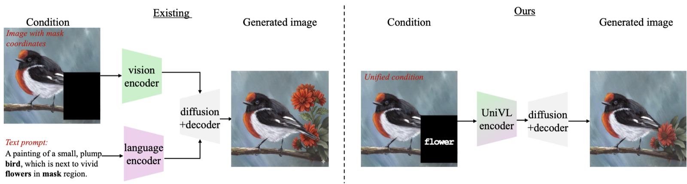

# UniVL: Unified Vision-Language Embedding for Spatially Grounded Contextual Image Generation

**NeurIPS 2026** · [Paper (arXiv:2605.21611)](https://arxiv.org/abs/2605.21611)



UniVL fills user-specified mask regions with content described by short labels. Each label is
written as text inside its mask, so a single image (the *contextual condition*) tells the model
both **what** to generate and **where**. An OCR-pretrained vision encoder reads this image, and
FLUX.1-dev generates the result conditioned only on the encoder output; no text encoder is
needed. Several labeled regions are generated in one forward pass.

UniVL targets short, object-level labels (e.g., "car", "a wooden bench"). Labels that describe
style, negation, or relations between objects are outside its scope.

## How it works

| Component | Role |
|---|---|
| FLUX VAE encoder (frozen) | Encodes the condition image; its features are kept outside the masks. |
| CLIP backbone from DeepSeek-OCR (LoRA-tuned) | Reads the rendered labels; its features are used inside the masks. It keeps DeepSeek-OCR's SAM stem (frozen), as in the pretrained encoder. |
| Adapters | Project the CLIP features to the latent dimension and fuse them with the VAE features and the mask into condition tokens. |
| FLUX.1-dev DiT (LoRA) | Generates the image from the condition tokens. |

Training has two stages. **Stage 1** aligns the encoder output with the VAE latent of the target
image without running the DiT. **Stage 2** fine-tunes a LoRA on FLUX.1-dev, starting from the
Stage-1 encoder weights.

## Repository layout

```
univl/                   model code
  pipeline/flux_univl.py   condition encoding, FLUX sampling (generate), configuration flags
  training/                train.py (entry point), trainer.py, multibox_dataset.py
  deepencoder/             SAM / CLIP / projector modules adapted from DeepSeek-OCR
  paths.py                 data and weight locations (environment variables)
configs/                 Stage-1 and Stage-2 configs, plus Stage-2 ablation configs
scripts/                 training launchers
inference.py             generate an image from a source image, boxes, and labels
data/                    UniVL-ImgGen construction, evaluation-set builders, label statistics
evaluation/              UniVL evaluation, baselines, metrics, efficiency measurement
tools/                   DeepSeek-OCR weight extraction
```

## Setup

**1. Environment** (Python 3.10, CUDA 12.1; we trained on H100 80 GB GPUs):

```bash
bash setup_env.sh            # creates the conda env "univl"
conda activate univl
```

`conda env create -f environment.yml` installs the same pinned versions.

**2. FLUX.1-dev.** Accept the [FLUX.1-dev license](https://huggingface.co/black-forest-labs/FLUX.1-dev)
on Hugging Face and run `huggingface-cli login`.

**3. DeepSeek-OCR encoder weights.** Extract the vision-encoder weights from the
[DeepSeek-OCR](https://huggingface.co/deepseek-ai/DeepSeek-OCR) checkpoint:

```bash
python -m tools.extract_deepseek_ocr_vision_weights   # writes checkpoints/deepseek_ocr_vision.safetensors
```

**4. Paths.** All locations are set by environment variables (defaults in `univl/paths.py`):

| Variable | Default | Contents |
|---|---|---|
| `UNIVL_DATA_ROOT` | `data_root` | UniVL-ImgGen data (layout below) |
| `UNIVL_OUTPUT_ROOT` | `outputs` | evaluation sets, generated panels, metrics |
| `DEEPSEEK_OCR_WEIGHTS` | `checkpoints/deepseek_ocr_vision.safetensors` | encoder weights for inference and evaluation (training reads `model.deepseek_w_path` in the config) |
| `IMGEDIT_ROOT` | `imgedit/Singleturn` | released ImgEdit single-turn data |
| `COCO_ROOT` | `coco_val2017` | COCO val2017 (`val2017/`, `annotations/`) |
| `POWERPAINT_REPO`, `CONTROLNET_INPAINT_REPO` | `third_party/...` | code of two baselines (evaluation only) |

Run all commands from the repository root.

## Inference

<!-- TODO(authors): add the link to the released UniVL checkpoint. -->

A checkpoint directory contains `default.safetensors` (DiT LoRA) and
`omini_adapter.safetensors` (adapters and CLIP LoRA). Give one `--box x1 y1 x2 y2` (pixels in
the source image) and one `--label` per region. For example, to generate a dog and a bench in
two regions of `photo.jpg`:

```bash
python inference.py --ckpt runs/<run>/ckpt/<step> \
    --image photo.jpg \
    --box 40 220 230 470 --label dog \
    --box 260 260 500 470 --label "wooden bench" \
    --out outputs/photo_edit.png --save-condition
```

`--save-condition` also saves the condition image with the rendered labels. Rendering and
sampling settings are shared with `evaluation/eval_univl.py`.

## Data: UniVL-ImgGen

UniVL-ImgGen combines a *mask* category (object boxes in LAION images, with single- and
multi-box records) and three image-editing categories (add, replace, extract) taken from the
released [ImgEdit](https://arxiv.org/abs/2505.20275) data. Training expects:

```
$UNIVL_DATA_ROOT/
├── laion-aes/                                  # images
├── jsons/part*_step4_aes_clip_withcount/       # per-image object annotations
├── textmask_square/metadata_coords_bbox.jsonl  # mask category
├── textmask_add_laion/metadata_coords2.json    # ImgEdit add
├── textmask_replace_laion/metadata_coords2.json
├── textmask_extract_ref/metadata_coords2.json
├── multibox_filtered.jsonl                     # multi-box records
└── test_masks/stest.jsonl                      # optional: records for validation samples
```

<!-- TODO(authors): state where to obtain laion-aes/ and jsons/ (not distributed with this repository). -->

| Script | Reads | Writes |
|---|---|---|
| `bash data/laion/extract_laion.sh`, `bash data/laion/fix_laion_nesting.sh` | `laion-aes/*.tar` | `laion-aes/<shard>/` |
| `python -m data.build_mask_category` | `jsons/`, `laion-aes/` | `textmask_square/` |
| `python -m data.imgedit.build_{add,replace,extract}` | `$IMGEDIT_ROOT` | `textmask_{add_laion,replace_laion,extract_ref}/` |
| `python -m data.build_multibox_jsonl`, `python -m data.filter_multibox_jsonl` | `jsons/`, `laion-aes/` | `multibox_filtered.jsonl` |
| `python -m data.clean_metadata`, `data.fix_metadata_bbox`, `data.fix_mask_category_bbox`, `data.clean_mask_category_jsonl` | category metadata | cleaned metadata with mask boxes |
| `python -m data.analyze_label_vocabulary` | training metadata | label statistics and plots |

## Training

```bash
# Stage 1: encoder alignment (no DiT forward pass)
bash scripts/train_stage1.sh
# Stage 2: set model.trained_adapter_path in configs/stage2_diffusion.yaml to the
# path printed at the end of Stage 1, then
bash scripts/train_stage2.sh
```

Each launcher reads `UNIVL_CONFIG` and `CUDA_VISIBLE_DEVICES`, so any config can be run with,
for example, `UNIVL_CONFIG=configs/stage2_diffusion_lora_r8.yaml bash scripts/train_stage2.sh`.
Set `WANDB_API_KEY` to log to Weights & Biases. Each run writes `runs/<timestamp>/`, containing
checkpoints (`ckpt/<step>/`), validation samples (`output/`), and the config used.

| Config | Purpose |
|---|---|
| `configs/stage1_alignment.yaml` | Stage 1 |
| `configs/stage2_diffusion.yaml` | Stage 2 (UniVL) |
| `configs/stage2_diffusion_lora_r8.yaml` | LoRA rank 8 |
| `configs/stage2_diffusion_res256.yaml` | 256×256; set `RES256 = True` in `univl/pipeline/flux_univl.py` |
| `configs/stage2_diffusion_res1024.yaml` | 1024×1024; set `RES1024 = True` in `univl/pipeline/flux_univl.py` |

The encoder ablations are selected by flags at the top of `univl/pipeline/flux_univl.py`:
`AB_VAE = True` (VAE encoder only) and `SIGCLIP_ENCODER = True` (SigLIP instead of the
OCR-pretrained CLIP). Training reads these flags at import time.

## Evaluation

Build the evaluation sets, then evaluate a checkpoint:

```bash
python -m data.eval_sets.build_univl_imggen_eval   # single-box and multi-box sets in $UNIVL_OUTPUT_ROOT
python -m evaluation.eval_univl --ckpt runs/<run>/ckpt/<step> --gpu 0
```

The script saves `[condition | generated | ground truth]` panels and a `metrics.json` with FID,
SSIM, PSNR, MUSIQ, and CLIP image-text and image-image similarity
(`openai/clip-vit-large-patch14`), the latter also computed on the masked region. Useful options:
`--prompt-mode class` (UniVL+T5: also pass the label to T5), `--seed`, `--eval-jsonl` with
`--no-rerender-text --single-box-only` for sets with pre-rendered conditions, and
`--vae-only` / `--sigclip-encoder` / `--two-condition` for checkpoints trained with those flags.

| Script | Purpose |
|---|---|
| `data/eval_sets/coco_test*.py`, `data/eval_sets/freeform_test*.py` | COCO val2017 and free-form (convex-hull) mask sets; the `_blank` variants leave the mask empty for baselines |
| `evaluation/baselines/eval_{ominicontrol,flux_fill,controlnet_flux,brushnet,powerpaint}.py` | baselines on the same sets; FLUX.1 Fill and ControlNet-FLUX need `diffusers>=0.32` in a separate environment |
| `evaluation/metrics_from_panels.py` | recompute metrics from saved panels |
| `evaluation/aggregate_seeds.py` | mean and standard deviation over seeds |
| `evaluation/mask_count/` | results by number of masks per image |
| `evaluation/fid/` | sharded inference and FID against a fixed set of reference images |
| `evaluation/efficiency/` | tokens, parameters, FLOPs, and runtime with and without the text encoders |

## Citation

```bibtex
@inproceedings{wang2026univl,
  title         = {{UniVL}: Unified Vision-Language Embedding for Spatially Grounded Contextual Image Generation},
  author        = {Wang, Jiayun and Wang, Yu and Gan, Weijie and Wang, Zhenting and Wei, Wei},
  booktitle     = {Advances in Neural Information Processing Systems (NeurIPS)},
  year          = {2026},
  eprint        = {2605.21611},
  archivePrefix = {arXiv},
  primaryClass  = {cs.CV}
}
```

## Acknowledgments and license

This code builds on [OminiControl](https://github.com/Yuanshi9815/OminiControl)
([arXiv:2411.15098](https://arxiv.org/abs/2411.15098), Apache 2.0), whose FLUX conditioning and
training code we extended. The modules in `univl/deepencoder/` and the encoder weights come from
[DeepSeek-OCR](https://github.com/deepseek-ai/DeepSeek-OCR) (MIT). The editing categories of
UniVL-ImgGen come from [ImgEdit](https://arxiv.org/abs/2505.20275).

The code is released under the Apache License 2.0 (see `LICENSE`). FLUX.1-dev and models
fine-tuned from it are subject to the
[FLUX.1 [dev] Non-Commercial License](https://huggingface.co/black-forest-labs/FLUX.1-dev).
